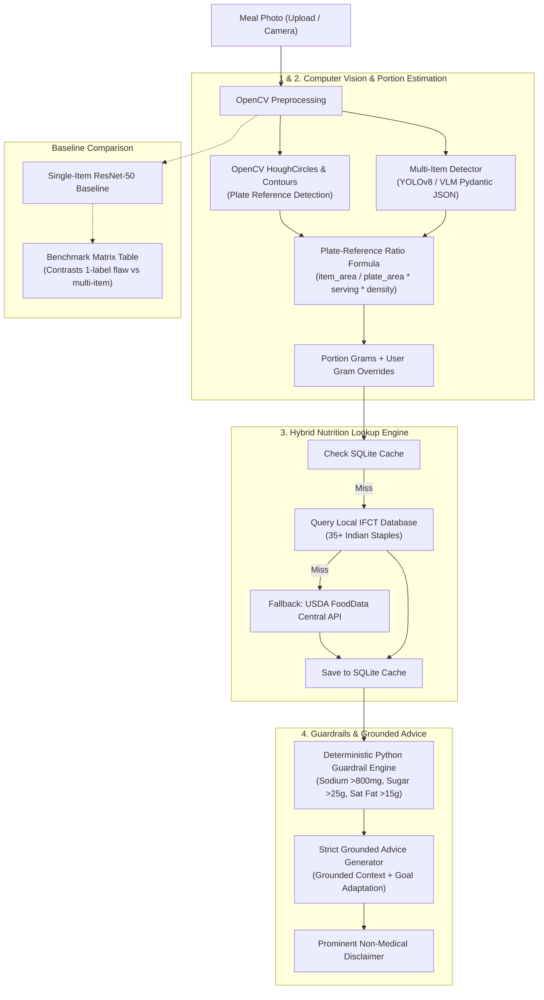

# 🥗 AI Diet Analyzer Pro – Smart Multi-Item Nutrition & Guardrail System

[](https://www.python.org/downloads/)
[](https://streamlit.io)
[](https://opencv.org/)
[](https://ultralytics.com/)
[](https://opensource.org/licenses/MIT)

An advanced Computer Vision and Nutrition Science system designed to solve the real-world complexities of analyzing multi-dish meals (e.g., Indian Thalis, buffet plates, mixed bowls). 

---

## 🌟 The Four Core Technical Upgrades

### 1. Multi-Item Detection Instead of Single-Label Classification
- **Why**: Traditional CNN image classifiers (ResNet-50, EfficientNet) output exactly **one label** for an entire photo. When presented with a real-world thali containing rice, dal tadka, roti, paneer bhurji, and salad, single-label classifiers collapse the entire frame into a single tag (e.g. *"Plate of food"* or *"Steamed Rice"*), missing 60–80% of the meal's nutritional content.
- **The Upgrade**: 
  - Integrated **YOLOv8** single-stage anchor-free object detector for spatial localization.
  - Implemented a **Multimodal Vision-Language Model (Gemini Vision)** fallback equipped with strict **Pydantic JSON schemas**, outputting normalized bounding boxes `[ymin, xmin, ymax, xmax]`, confidences, and food categories.
  - Kept **ResNet-50 Single-Item Baseline** inside an interactive benchmark evaluation suite to demonstrate why multi-bounding-box localization is required.

#### 📊 Architectural Benchmark Comparison

| Feature / Metric | Single-Item Baseline (ResNet-50 / EfficientNet) | YOLOv8 Multi-Item Detector | Multi-Item VLM (Gemini Structured Vision) |
| :--- | :--- | :--- | :--- |
| **Architecture** | Global 2D CNN Softmax | Single-Stage Anchor-Free Detector | Multimodal Transformer with Pydantic JSON |
| **Items Detected on Thali** | Exactly 1 label | Multiple bounding boxes | 4–8 distinct dishes (Rice, Dal, Roti, Sabzi) |
| **Spatial Bounding Boxes** | ❌ None | ✅ Yes (`[xmin, ymin, xmax, ymax]`) | ✅ Yes (Normalized `[ymin, xmin, ymax, xmax]`) |
| **Portion Estimation Viability** | ❌ Impossible | ✅ High (Box Area / Plate Area) | ✅ Highest (Per-Item Area / Plate Area + Density) |
| **Indian Staples Recognition** | ⚠️ Poor (ImageNet class gaps) | ⚠️ Moderate (Needs custom classes) | 🌟 Exceptional (Zero-shot recipe understanding) |
| **Typical Latency** | ~20 ms | ~30 ms | ~600 ms |

---

### 2. Explicit Portion Estimation Formula (Plate-Reference Ratio)
- **Why**: 2D RGB photos lack depth ($z$-axis). Converting bounding-box pixels into physical mass (grams) requires a spatial calibration reference and density compensation.
- **The Upgrade**:
  - Implemented the **Plate-Reference Bounding-Box Ratio** using OpenCV:
    1. **Plate Contour Detection:** Uses `cv2.HoughCircles` and adaptive morphological contour fitting (`minEnclosingCircle`) to detect the dining plate boundary:
       $$\text{Plate Area } (A_{\text{plate}}) = \pi \cdot r^2$$
    2. **Item Footprint Approximation:** Applies elliptical correction to bounding-box coordinates $[x_{\min}, y_{\min}, x_{\max}, y_{\max}]$:
       $$\text{Item Area } (A_{\text{item}}) = (x_{\max} - x_{\min}) \cdot (y_{\max} - y_{\min}) \times \frac{\pi}{4}$$
    3. **Portion Estimation Formula:**
       $$\text{Estimated Mass (g)} = \left(\frac{A_{\text{item}}}{A_{\text{plate}}}\right) \times \text{Standard Plate Full Serving (g)} \times \rho_{\text{food}}$$
    4. **Density Factor Mapping ($\rho_{\text{food}}$):** Calibrated specific mass densities (e.g., Dal $\rho=1.05$, Steamed Rice $\rho=0.85$, Roti $\rho=0.65$, Salad $\rho=0.35$, Paneer $\rho=1.10$).
    5. **User Gram Overrides:** Interactive UI inputs allow users to override algorithmic gram estimations at any time.
    6. **OpenCV Visual Overlay:** Draws plate contour circles and bounding box badges with calculated grams.

---

### 3. Hybrid Nutrition Lookup (IFCT + USDA FoodData Central + SQLite Cache)
- **Why**: Pure USDA FoodData Central misses Indian staples (*dal tadka, paneer bhurji, chapati, poha, idli, sambar*) or returns inaccurate macro/micronutrient ratios. Furthermore, repeated remote API calls hit rate limits and introduce network latency.
- **The Upgrade**:
  - **Tier 1 (Curated Local IFCT):** Over 35+ verified Indian staples based on Indian Food Composition Tables (NIN-ICMR) with complete macros, sodium, added sugar, saturated fat, and micronutrients.
  - **Tier 2 (USDA FoodData Central API):** Automatic fallback query to the official USDA FDC API for international items and packaged ingredients.
  - **Tier 3 (Persistent SQLite Cache):** Caches queried food profiles locally (`.cache/nutrition_cache.db`) with hit counters and timestamps, eliminating redundant external API queries.

---

### 4. Deterministic Threshold Guardrails + Grounded Advice
- **Why**: Large Language Models must **never** be permitted to invent medical advice or hallucinate caloric/nutrient figures.
- **The Upgrade**:
  - **Deterministic Python Arithmetic Validation:** Hard macro and micro thresholds are computed deterministically before any LLM prompt is constructed:
    - 🔴 **Critical Sodium:** $\ge 1200\text{ mg}$ | 🟡 **High Sodium:** $\ge 800\text{ mg}$ (AHA / WHO limit)
    - 🔴 **Critical Added Sugar:** $\ge 36\text{ g}$ | 🟡 **High Free Sugar:** $\ge 25\text{ g}$ (WHO recommended daily cap)
    - 🔴 **Critical Saturated Fat:** $\ge 22\text{ g}$ | 🟡 **High Saturated Fat:** $\ge 15\text{ g}$ (AHA cardiovascular limit)
    - 🟡 **High Calorie Surplus:** $\ge 800\text{ kcal}$ single meal
    - 🟡 **Low Protein Intake:** $< 15\text{ g}$ in a meal $> 250\text{ kcal}$
    - 🔵 **High Carbohydrate Energy Ratio:** $> 65\%$ of calories from carbohydrates
  - **Grounded Advice Generator:** Passes verified alerts into a constrained structured prompt for practical swaps (or runs locally via rule-based heuristics if offline).
  - **Mandatory Clinical Disclaimer:** Prominently displays an explicit non-medical disclaimer on all analyses.

---

## 🏛️ System Architecture



---

## 🚀 Installation & Quickstart

### Prerequisites
- Python 3.10+ (Tested up to Python 3.14)
- Pip

### 1. Clone & Install
```bash
git clone https://github.com/priyanshugautam1234/ai-diet-analyzer.git
cd ai-diet-analyzer

pip install -r requirements.txt
```

### 2. Configure Environment (Optional)
Create or edit `.env` in the root directory:
```env
GOOGLE_API_KEY="your_gemini_api_key_here"
USDA_API_KEY="your_usda_api_key_here"  # Default fallback uses USDA DEMO_KEY
```

### 3. Launch the Application
```bash
streamlit run app.py
```
*(Or run `streamlit run healthapp.py`)*

---

## 🧪 Running Unit Tests

The test suite thoroughly verifies all four upgrades across detection, OpenCV portion calculations, IFCT lookups, SQLite caching, and guardrail limits:

```bash
python -m pytest tests/ -v
```

**Test Coverage Summary:**
- `tests/test_detection.py`: Verifies Single-Item Baseline, YOLOv8 localization, and benchmark matrices.
- `tests/test_portion.py`: Verifies HoughCircles plate contour, area ratio formula, density factors, and overrides.
- `tests/test_nutrition.py`: Verifies IFCT Indian staples lookups, SQLite caching and hits, and portion scaling.
- `tests/test_guardrails.py`: Verifies deterministic arithmetic threshold flags and disclaimer enforcement.

---

## 📜 Clinical & Non-Medical Disclaimer

> ⚠️ **DISCLAIMER:** This application and its nutritional estimations, portion calculations, and dietary suggestions are generated algorithmically for lifestyle and educational purposes only. They do not constitute medical advice, clinical diagnosis, or a therapeutic prescription. Always consult a registered dietitian, physician, or qualified medical professional before making clinical dietary interventions.
